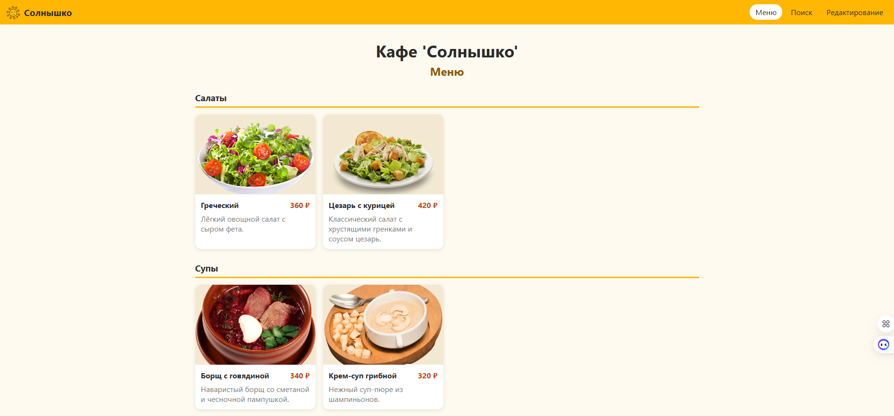
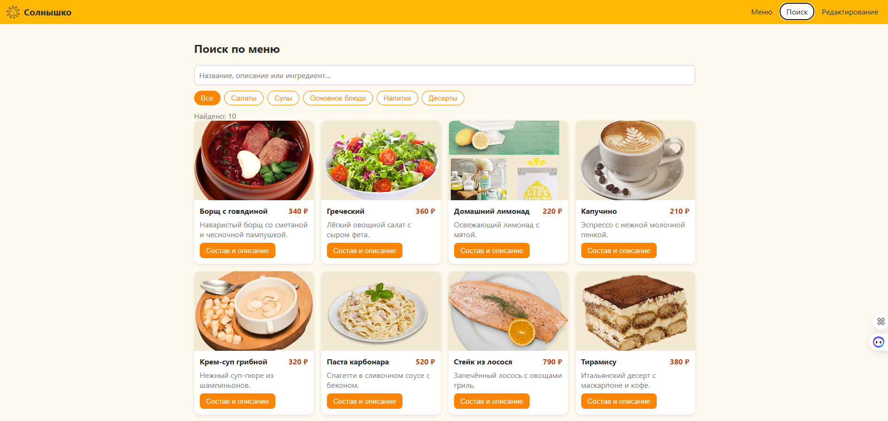
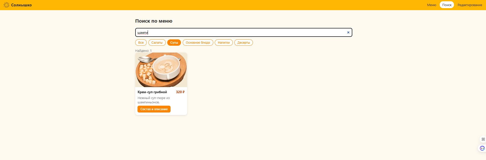
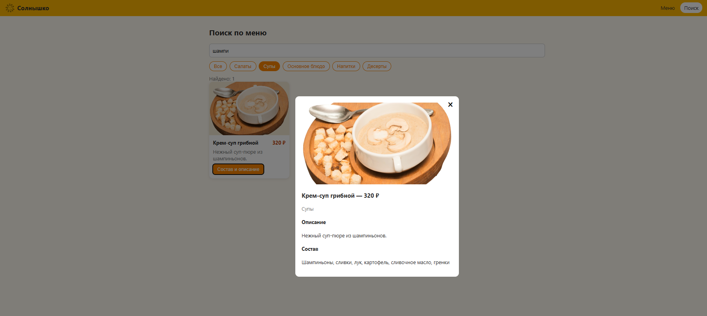
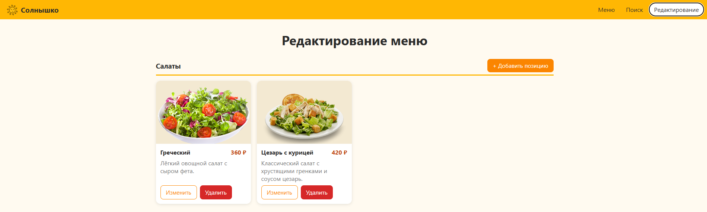
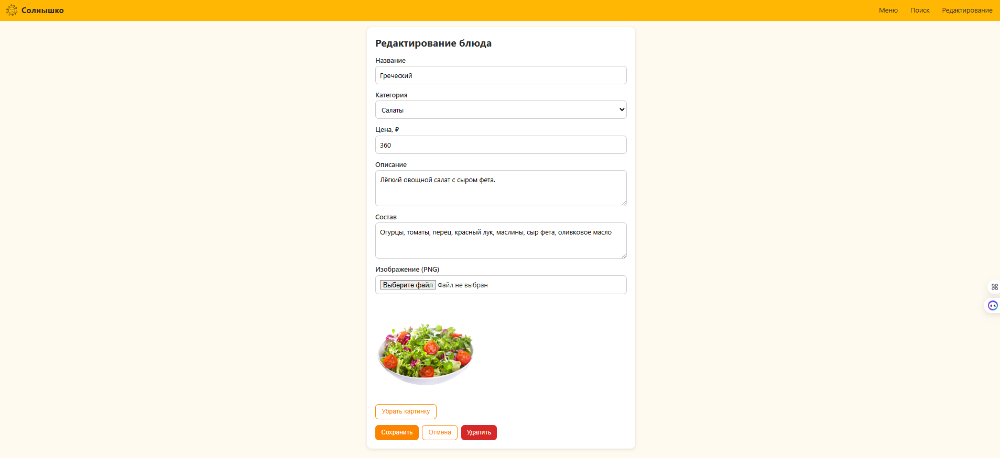
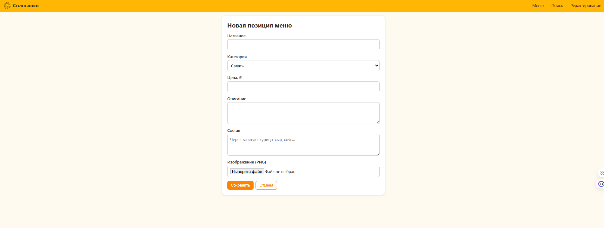

# Кафе «Солнышко» — ЛР №1 (API на Go/Gin/Postgres) + ЛР №2 (React-клиент)

Единый проект: одно решение, один `docker-compose.yml`.

## Быстрый старт

```bash
docker compose up -d --build
```

- Сайт: http://localhost (только HTTP)
- Swagger UI: http://localhost/swagger  (или `/api/swagger/index.html`)
- Спецификация OpenAPI: http://localhost/api/openapi.json

### Масштабирование

По умолчанию `BACKEND_REPLICAS=2`, `FRONTEND_REPLICAS=2` (см. `.env`). Через scale:

```bash
docker compose up -d --scale backend=4 --scale frontend=3
```

Nginx и HAProxy заново резолвят DNS Docker каждые ~5 с и подхватывают новые реплики автоматически.

### Данные (volumes)

- `./data/postgres` — файлы PostgreSQL.
- `./data/uploads` — загруженные PNG (общий для всех реплик backend).
- `./db/init/*.sql` — создание таблиц (`01_schema.sql`) и начальные данные (`02_seed.sql`); выполняются **только при первом старте**, пока `./data/postgres` пуст. Сброс: `docker compose down && rm -rf data/postgres`.

## Адреса и порты nginx (всё из `.env`)

| Переменная | Назначение |
|---|---|
| `HTTP_BIND_ADDRESS` | на каком интерфейсе хоста слушает сайт (`0.0.0.0` / `127.0.0.1` / конкретный IP) |
| `HTTP_PORT` | порт на хосте (80) |
| `NGINX_LISTEN_PORT` | порт nginx внутри контейнера |
| `NGINX_SERVER_NAME` | `server_name` (домен сайта, `_` = любой) |
| `NGINX_RESOLVER` | DNS Docker (`127.0.0.11`) для поиска реплик |
| `FRONTEND_HOST`, `FRONTEND_PORT` | куда nginx проксирует сайт |
| `HAPROXY_HOST`, `HAPROXY_PORT` | куда nginx проксирует `/api/` |

Как это работает: `nginx/default.conf.template` монтируется в `/etc/nginx/templates/`. При старте официальный образ nginx прогоняет шаблон через `envsubst` (подставляет `${...}` из переменных окружения контейнера) и сохраняет как `/etc/nginx/conf.d/default.conf`. Публикация порта: `ports: "${HTTP_BIND_ADDRESS}:${HTTP_PORT}:${NGINX_LISTEN_PORT}"`. Чтобы изменить адрес — правьте `.env` и выполните `docker compose up -d`.

## Архитектура

```
Браузер :80 -> nginx (балансировщик сайта)
                    /       -> frontend ×N (nginx + React build)
                    /api/*  -> haproxy (балансировщик API) ─► backend ×N (Go/Gin) ─► postgres
```

## Структура проекта

```
.env                      # все настройки
docker-compose.yml
db/init/                  # 01_schema.sql, 02_seed.sql
backend/                  # Go + Gin
  main.go                 # точка входа
  config.go               # конфигурация из env
  database.go             # подключение к Postgres
  models.go               # структуры данных
  repository.go           # SQL-запросы
  httpx.go                # хелперы ответов и ошибок
  handler.go              # зависимости обработчиков
  handler_menu.go         # CRUD, поиск, фильтры, сортировка, пагинация
  handler_categories.go
  handler_images.go       # загрузка PNG
  handler_system.go       # health, openapi
  router.go               # маршруты, CORS, Swagger
  openapi.json            # описание для Swagger UI
frontend/                 # React + axios + CSS (Vite)
  src/api.js
  src/hooks/useMenuData.js
  src/pages/              # Home (Меню), Admin (Редактирование), DishForm, Search
  src/components/DishCard.jsx
nginx/default.conf.template   # балансировщик сайта
haproxy/haproxy.cfg           # балансировщик API
docs/screenshots/
```

## Структура БД

- `categories(id, name, description)`
- `images(id, path, attributes JSONB)` — attributes:
  `{"filename","original_name","mime_type","size_bytes","width","height","alt","uploaded_at"}`
- `menu(id, name UNIQUE, category_id → categories, description, ingredients, image_id → images, price)`

## Маршруты API

| Метод | Путь | Описание |
|---|---|---|
| GET | /api/health | проверка |
| GET | /api/categories | категории |
| GET | /api/menu | список; `category_id`, `search`, `sort` (id/name/price/category), `order` (asc/desc), `page`, `limit` |
| GET | /api/menu/{id} | блюдо |
| POST | /api/menu | создать |
| PUT | /api/menu/{id} | изменить |
| DELETE | /api/menu/{id} | удалить |
| POST | /api/images | загрузить PNG (multipart: `file`, `alt`) |
| GET | /api/uploads/{file}.png | статика изображений |

Валидация: `name` обязателен (≤120, уникален → 409), `category_id` существует, `price` > 0, тексты ≤ 2000, изображение — только PNG (проверка по содержимому), размер ≤ `MAX_UPLOAD_MB`.

## Примеры запросов

```bash
curl "http://localhost/api/menu?category_id=2&search=гриб&sort=price&order=desc&page=1&limit=10"

curl -F "file=@salad.png" -F "alt=Салат" http://localhost/api/images

curl -X POST http://localhost/api/menu -H "Content-Type: application/json" \
  -d '{"name":"Окрошка","category_id":2,"price":290,"description":"Холодный суп","ingredients":"квас, огурцы, яйцо","image_id":1}'

curl -X PUT http://localhost/api/menu/11 -H "Content-Type: application/json" \
  -d '{"name":"Окрошка","category_id":2,"price":310}'
curl -X DELETE http://localhost/api/menu/11
```

## Экраны

1. `/` **Меню** — заголовок «Кафе 'Солнышко'», «Меню», позиции по категориям. Только просмотр.

2. `/search` **Поиск** — строка поиска, фильтры-чипы по категориям, окно «Состав и описание». Только просмотр.



3. `/admin` **Редактирование** — все позиции по категориям с кнопками «Изменить»/«Удалить» и «+ Добавить позицию» в каждой категории (открывает форму `/dish/new?category=ID`, `/dish/:id/edit`: категория, цена, описание, состав, PNG).




## CORS

Бэкенд использует `gin-contrib/cors`; разрешённые источники — `CORS_ALLOWED_ORIGINS` в `.env` (через запятую, `*` — все). Фронт обращается к `/api` на том же origin через nginx; для `npm run dev` (порт 5173) добавьте `http://localhost:5173` в `CORS_ALLOWED_ORIGINS`.
